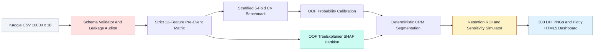
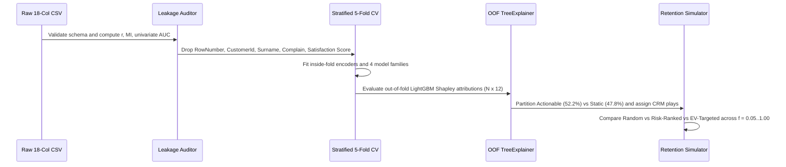
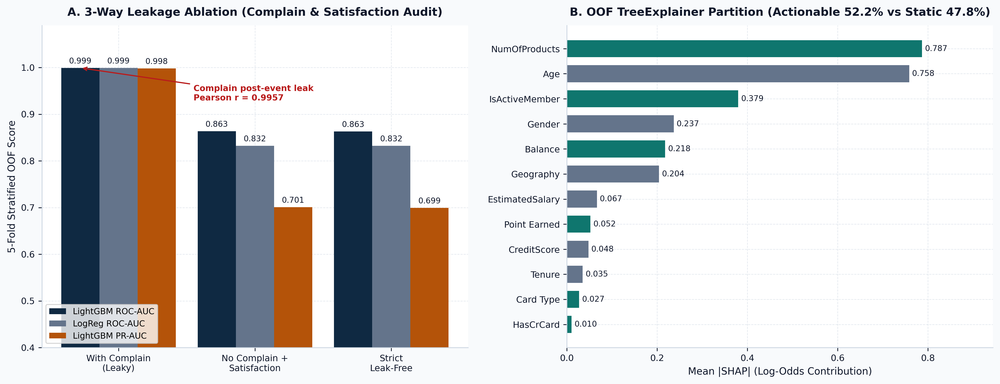
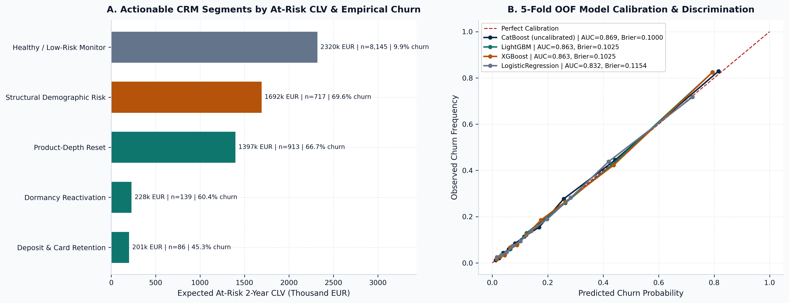
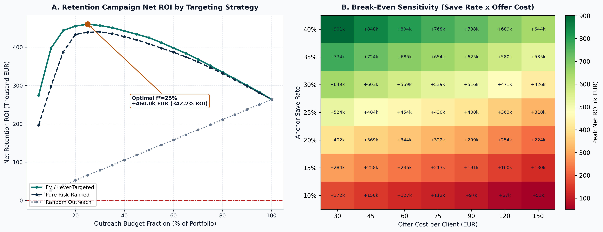

<div align="center">

# BCCRI - Bank Customer Churn & Retention Intelligence
### Leak-Free Stratified CV, OOF Actionable SHAP Levers & Unit-Economics Retention ROI

<br/>


**A retail-banking retention intelligence system engineered to separate post-event target leakage from genuinely actionable product, engagement, and deposit levers.**  
From 10,000 retail accounts to calibrated churn risk, out-of-fold Shapley segmentation, and EV-optimized campaign budget allocation.

</div>

<br/>

<table align="center">
<tr>
<td align="center"><h2>10,000</h2><sub>retail bank accounts</sub></td>
<td align="center"><h2>0.8694</h2><sub>CatBoost OOF ROC-AUC</sub></td>
<td align="center"><h2>0.9957 &rarr; 0</h2><sub>Complain leakage removed</sub></td>
<td align="center"><h2>52.2%</h2><sub>Actionable SHAP share</sub></td>
<td align="center"><h2>&plus;460,015 &euro;</h2><sub>Peak Net ROI (f* = 25%)</sub></td>
<td align="center"><h2>342.2%</h2><sub>Optimal campaign ROI</sub></td>
</tr>
</table>

---

## Table of Contents

1. [Banking Context & Leakage Problem](#banking-context--leakage-problem)
2. [System Architecture](#system-architecture)
3. [Tech Stack & Domain Structure](#tech-stack--domain-structure)
4. [Complete Variable Dictionary (18 Raw + Engineered)](#complete-variable-dictionary-18-raw--engineered)
5. [Leakage Audit & 3-Way Ablation](#leakage-audit--3-way-ablation)
6. [Model Zoo, Hyperparameters & Stratified CV Benchmark](#model-zoo-hyperparameters--stratified-cv-benchmark)
7. [Actionable SHAP Decomposition & CRM Segments](#actionable-shap-decomposition--crm-segments)
8. [Retention ROI Simulation & Sensitivity](#retention-roi-simulation--sensitivity)
9. [Interactive Dashboard & Executed Notebook](#interactive-dashboard--executed-notebook)
10. [Quickstart & Reproduction](#quickstart--reproduction)
11. [Project Structure](#project-structure)
12. [Scientific Conclusion](#scientific-conclusion)

---

## Banking Context & Leakage Problem

Predicting retail bank attrition (`Exited` in `{0, 1}`, 20.38% churn across 10,000 accounts) on the Kaggle Bank Customer Churn extension introduces three critical modeling and economic pitfalls:

| Challenge | Na&iuml;ve Approach Failure | How BCCRI Solves It |
|---|---|---|
| **Post-Event Target Leakage (`Complain`)** | `Complain` correlates at Pearson `r = 0.9957` with `Exited` (9,986/10,000 exact matches), inflating CV ROC-AUC to `0.9991` on post-exit complaint records | Automated univariate leakage audit + 3-way ablation removing `Complain` and auditing `Satisfaction Score` |
| **Non-Monotonic Product & Balance Regimes** | `NumOfProducts` exhibits a steep J/U-curve (`1`: 27.7%, `2`: 7.6%, `3`: 82.7%, `4`: 100.0% churn) and `Balance == 0` accounts (36.17%) never occur in Germany (`0/2,509`) | Inside-fold categorical/product encoding for linear models and non-linear GBDT splits with zero-balance CLV floor handling |
| **Wasted Retention Incentives** | Pure risk-ranking targets high-churners driven by static demographics (`Age`, `Geography`) or low-balance accounts where offer cost exceeds saveable CLV | Out-of-fold `shap.TreeExplainer` partitioning into **Actionable Levers** vs **Static Context**, feeding an EV-ranked CRM simulator |

---

## System Architecture

### End-to-End Domain Pipeline



### Leak-Free Cross-Fitting & ROI Sequence



---

## Tech Stack & Domain Structure

`BCCRI` strictly follows `ELMAS.md` with unidirectional dependencies (`visualization -> evaluation -> modeling -> features -> ingestion -> core`), `<= 350` lines per file, `<= 3` indentation levels, `<= 3` parameters per function via frozen `@dataclass(frozen=True)` contracts, and zero catch-all folders:

| Domain Package | Responsibility | Key Modules |
|---|---|---|
| `src/core/` | Frozen configs & typed domain contracts | `churn_config.py`, `churn_contracts.py` |
| `src/ingestion/` | Kaggle CLI download (`KAGGLE_CONFIG_DIR`) & schema assertions | `kaggle_churn_loader.py` |
| `src/features/` | Target leakage audit, 3-way ablation builders, inside-fold encoding | `leakage_auditor.py`, `churn_feature_pipeline.py` |
| `src/modeling/` | 5-fold Stratified CV (4 families) & OOF Platt/Isotonic calibration | `stratified_benchmark.py`, `probability_calibrator.py` |
| `src/evaluation/` | OOF `shap.TreeExplainer` lever partition, CRM segments, ROI simulator | `shap_lever_segmenter.py`, `retention_roi_simulator.py` |
| `src/visualization/` | 300 DPI Matplotlib figures & `tabular-nums` Plotly HTML5 report | `churn_matplotlib_plots.py`, `churn_plotly_dashboard.py` |

---

## Complete Variable Dictionary (18 Raw + Engineered)

| Variable | Origin | Type | Domain Role | Business & Modeling Significance |
|---|---|---|---|---|
| `RowNumber` | Raw | `int64` | Dropped ID | Sequential row index (`1..10,000`); excluded to prevent index artifacts |
| `CustomerId` | Raw | `int64` | Dropped ID | Unique account key (`10,000` unique); excluded from features |
| `Surname` | Raw | `object` | Dropped PII | Customer surname (`2,932` unique, `92` `?` encoding artifacts); excluded |
| `Complain` | Raw | `int64` | **Excluded Leakage** | Post-exit complaint flag (`r = 0.9957` with `Exited`); audited then dropped |
| `Satisfaction Score` | Raw | `int64` | **Audit Ablated** | Post-resolution survey (`1..5`, `r = -0.0058`); excluded from primary model |
| `IsActiveMember` | Raw | `int64` | **Actionable Lever** | Active banking engagement flag (`51.5%` active); 2nd strongest actionable lever |
| `NumOfProducts` | Raw | `int64` | **Actionable Lever** | Product count (`1..4`); non-monotonic risk (`2` = 7.6% churn vs `3/4` = 82.7%/100%) |
| `Balance` | Raw | `float64` | **Actionable Lever** | Deposit balance (`0.0..250,898 EUR`); `36.17%` zero-balance cluster |
| `HasCrCard` | Raw | `int64` | **Actionable Lever** | Credit card ownership flag (`70.6%` holders); gates card-tier upgrade actions |
| `Card Type` | Raw | `object` | **Actionable Lever** | Card tier (`DIAMOND`, `GOLD`, `SILVER`, `PLATINUM`); populated even when `HasCrCard=0` |
| `Point Earned` | Raw | `int64` | **Actionable Lever** | Loyalty points (`119..1,000`, mean `606.5`); targeted in dormancy bonuses |
| `CreditScore` | Raw | `int64` | Static Context | Credit bureau score (`350..850`, mean `650.5`) |
| `Geography` | Raw | `object` | Static Context | Country (`France` 50.1%, `Germany` 25.1%, `Spain` 24.8%); Germany 32.4% churn |
| `Gender` | Raw | `object` | Static Context | Client gender (`Male` 54.6%, `Female` 45.4%) |
| `Age` | Raw | `int64` | Static Context | Age (`18..92`, mean `38.9`); churn peaks in `45..59` cohort (49.5%) |
| `Tenure` | Raw | `int64` | Static Context | Banking tenure in years (`0..10`) |
| `EstimatedSalary` | Raw | `float64` | Static Context | Annual salary estimate (`11.58..199,992 EUR`); fee-proxy component of CLV |
| `Exited` | Raw | `int64` | **Target** | Binary churn indicator (`0`: 7,962 retained, `1`: 2,038 churned, 20.38%) |
| `is_zero_balance` | Engineered | `int64` | Linear Diagnostic | Indicator `Balance == 0.0` used inside `LogisticRegression` fold pipeline |
| `balance_to_salary_ratio` | Engineered | `float64` | Linear Diagnostic | `Balance / max(EstimatedSalary, 1.0)` deposit-to-income depth ratio |
| `has_multi_product_risk` | Engineered | `int64` | Linear Diagnostic | Indicator `NumOfProducts >= 3` capturing extreme J-curve churn risk |

---

## Leakage Audit & 3-Way Ablation

| Scenario | Model | Features | OOF ROC-AUC | OOF PR-AUC | Optimal F1 | OOF Brier |
|---|---|---:|---:|---:|---:|---:|
| `leaky_with_complain` | `LightGBM` | 14 | **0.9991** | **0.9979** | 0.9966 | 0.0014 |
| `leaky_with_complain` | `LogisticRegression` | 14 | 0.9989 | 0.9963 | 0.9966 | 0.0014 |
| `no_complain_with_satisfaction` | `LightGBM` | 13 | 0.8634 | 0.7006 | 0.6224 | 0.1024 |
| `no_complain_with_satisfaction` | `LogisticRegression` | 13 | 0.8323 | 0.6223 | 0.5755 | 0.1154 |
| `strict_leak_free` | `LightGBM` | 12 | **0.8630** | **0.6994** | 0.6223 | 0.1025 |
| `strict_leak_free` | `LogisticRegression` | 12 | 0.8324 | 0.6223 | 0.5771 | 0.1154 |

- **`Complain` Leakage Delta**: Removing `Complain` (`r = 0.9957`, univariate AUC `0.9984`) eliminates `+0.1361` of illusory ROC-AUC inflation (`0.9991 -> 0.8630`).
- **`Satisfaction Score` Sensitivity**: Across scores `1..5`, churn rates remain virtually flat (`19.64%` to `21.80%`, `r = -0.0058`), shifting LightGBM ROC-AUC by only `+0.0004` (`0.8630 -> 0.8634`). Excluding it keeps the production model 100% free of post-complaint survey timing bias.

<div align="center">
  
  <br/>
  <sub>Figure 1: Three-way leakage ablation (left) and out-of-fold TreeExplainer mean |SHAP| partition between Actionable Levers (52.2%) and Static Context (47.8%) (right).</sub>
</div>

---

## Model Zoo, Hyperparameters & Stratified CV Benchmark

All models are evaluated strictly out-of-fold on the **12 pre-event predictors** across identical `StratifiedKFold(n_splits=5, shuffle=True, random_state=42)` partitions with inside-fold encoding and OOF Platt/Isotonic calibration selection:

| Model Family | Paradigm | Key Regularized Hyperparameters | OOF ROC-AUC | OOF PR-AUC | Optimal F1 | Calibrated Brier | Calibrated ECE |
|---|---|---|---:|---:|---:|---:|---:|
| **CatBoost** | Symmetric Trees (Native Cat) | `iterations=500, lr=0.04, depth=5, l2_leaf_reg=6.0` | **0.8694** | **0.7126** | **0.6359** (`@0.31`) | **0.1000** (`uncalibrated`) | **0.0068** |
| **LightGBM** | Leaf-Wise GBDT | `n_estimators=350, lr=0.03, num_leaves=15, max_depth=4, min_child_samples=40, reg_lambda=5.0` | 0.8630 | 0.6994 | 0.6223 (`@0.34`) | 0.1025 (`platt_sigmoid`) | 0.0084 |
| **XGBoost** | Hist Depth-Wise GBDT | `n_estimators=350, lr=0.03, max_depth=4, min_child_weight=10.0, reg_lambda=5.0` | 0.8628 | 0.6994 | 0.6202 (`@0.27`) | 0.1025 (`uncalibrated`) | 0.0112 |
| **LogisticRegression** | Linear + Domain Flags | `C=1.0, max_iter=1000` + `OneHotEncoder(Geography, Gender, Card Type, NumOfProducts)` | 0.8324 | 0.6223 | 0.5771 (`@0.28`) | 0.1154 (`uncalibrated`) | 0.0062 |

---

## Actionable SHAP Decomposition & CRM Segments

Out-of-fold `shap.TreeExplainer` attributions verify that **52.22%** of total predictive signal originates from **Actionable Levers** (`NumOfProducts` `0.787`, `IsActiveMember` `0.379`, `Balance` `0.218`, `Point Earned` `0.052`, `Card Type` `0.027`, `HasCrCard` `0.010`), versus **47.78%** from **Static Context** (`Age` `0.758`, `Gender` `0.237`, `Geography` `0.204`, `EstimatedSalary` `0.067`, `CreditScore` `0.048`, `Tenure` `0.035`).

| CRM Segment | Clients | Share | Pred Risk | Actual Churn | Mean 2Y CLV | At-Risk CLV | Recommended Action |
|---|---:|---:|---:|---:|---:|---:|---|
| **Healthy / Low-Risk Monitor** | 8,145 | 81.5% | 9.9% | 9.9% | 2,418 &euro; | 2,319,619 &euro; | Passive monitoring (no costly incentive) |
| **Structural Demographic Risk** | 717 | 7.2% | 68.4% | 69.6% | 3,487 &euro; | 1,691,948 &euro; | Low-cost automated digital self-service retention |
| **Product-Depth Reset** | 913 | 9.1% | 64.5% | 66.7% | 2,285 &euro; | 1,396,618 &euro; | Portfolio consolidation review to 2-product sweet spot |
| **Dormancy Reactivation** | 139 | 1.4% | 62.9% | 60.4% | 2,727 &euro; | 227,708 &euro; | Omnichannel engagement nudge & loyalty point bonus |
| **Deposit & Card Retention** | 86 | 0.9% | 50.5% | 45.3% | 4,531 &euro; | 200,561 &euro; | Targeted deposit yield match or credit-card fee waiver |

<div align="center">
  
  <br/>
  <sub>Figure 2: Actionable CRM segments ranked by expected at-risk 2-year CLV (left) and 5-fold OOF probability reliability curves across all four models (right).</sub>
</div>

---

## Retention ROI Simulation & Sensitivity

Using a 2-year discounted CLV proxy (`1.50%` NIM on `Balance` + `0.25%` fee proxy on `EstimatedSalary`, `8%` discount rate, `250 EUR` floor) and segment-differentiated save elasticities (`8%` structural vs `22%-28%` actionable):

- **EV / Lever-Targeted Outreach** peaks at **`f* = 25%`** (`2,500` targeted clients), saving an expected **`179.9` clients** (`594,455 EUR` gross CLV saved vs `134,440 EUR` campaign cost) for a net gain of **`+460,015 EUR` (`342.2%` ROI)**.
- **Pure Risk-Ranked Outreach** peaks at `f = 30%` with `+440,087 EUR` - **`EV / Lever-Targeted` delivers `+19,929 EUR` incremental net profit** while cutting campaign outreach volume by 5 percentage points.
- **Random Outreach** at `f* = 25%` returns only `+65,905 EUR` (`+394,110 EUR` net advantage to EV-targeted prioritization).

<div align="center">
  
  <br/>
  <sub>Figure 3: Net Retention ROI curve comparing Random, Pure Risk-Ranked, and EV/Lever-Targeted policies (left) and 2D break-even sensitivity grid across save rates and offer costs (right).</sub>
</div>

---

## Interactive Dashboard & Executed Notebook

- **Executive Plotly Dashboard**: Open [`artifacts/dashboard.html`](artifacts/dashboard.html) in any browser for interactive Plotly charts, KPI strips, and `tabular-nums` CRM unit-economics tables.
- **Executed Walkthrough Notebook**: [`notebooks/bccri_churn_retention_roi_study.ipynb`](notebooks/bccri_churn_retention_roi_study.ipynb) reproduces every ingestion check, EDA edge case, leakage audit, CV benchmark, SHAP partition, and ROI figure with saved outputs.

---

## Quickstart & Reproduction

```powershell
# 1. Configure Kaggle credentials directory (if downloading fresh)
$env:KAGGLE_CONFIG_DIR = "..\PCCF"

# 2. Run the full end-to-end BCCRI pipeline (download, CV, SHAP, ROI, visuals)
.\run.ps1

# 3. Run the offline unit, leakage, and ELMAS.md AST invariant test suite
C:\Users\elmas\AppData\Local\Programs\Python\Python310\python.exe -m pytest -v
```

---

## Project Structure

```text
BCCRI/
├── .gitignore
├── ELMAS.md
├── README.md
├── pytest.ini
├── requirements.txt
├── main.py
├── run.ps1
├── artifacts/
│   ├── dashboard.html
│   └── results.json
├── data/
│   ├── processed/
│   └── raw/                    # Kaggle CSV excluded by .gitignore
├── images/
│   ├── bccri_actionable_segments.png
│   ├── bccri_leakage_audit_shap.png
│   └── bccri_retention_roi_simulation.png
├── notebooks/
│   └── bccri_churn_retention_roi_study.ipynb
├── src/
│   ├── core/
│   │   ├── churn_config.py
│   │   └── churn_contracts.py
│   ├── ingestion/
│   │   └── kaggle_churn_loader.py
│   ├── features/
│   │   ├── churn_feature_pipeline.py
│   │   └── leakage_auditor.py
│   ├── modeling/
│   │   ├── probability_calibrator.py
│   │   └── stratified_benchmark.py
│   ├── evaluation/
│   │   ├── retention_roi_simulator.py
│   │   └── shap_lever_segmenter.py
│   └── visualization/
│       ├── churn_matplotlib_plots.py
│       └── churn_plotly_dashboard.py
└── tests/
    ├── test_elmas_invariants.py
    ├── test_leakage_and_features.py
    └── test_modeling_shap_and_roi.py
```

---

## Scientific Conclusion

1. **Leakage Hygiene First**: Auditing and stripping `Complain` (`r = 0.9957`) removes illusory `0.9991` AUC scores and exposes the true pre-exit predictability ceiling (`0.8694` ROC-AUC with `CatBoost`, `0.0068` ECE).
2. **Actionability Beyond Prediction**: Over half (`52.2%`) of out-of-fold TreeExplainer signal comes from modifiable banking levers (`NumOfProducts`, `IsActiveMember`, `Balance`), enabling targeted retention playbooks rather than blind discounting.
3. **Unit-Economics Discipline**: Ranking retention outreach by `Net EV = p_cal * save_rate * CLV - cost` rather than raw churn risk avoids subsidizing `717` structurally driven demographic churners (`8%` save elasticity) and low-balance accounts, achieving **`+460,015 EUR`** net value at **`25%`** portfolio coverage (`+19,929 EUR` over pure risk ranking).

---

*Author: **Elmas** (`elm-as`) - ElmasCore Data Science Portfolio*
